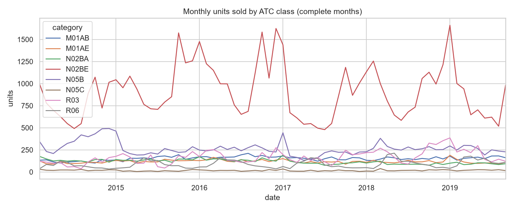
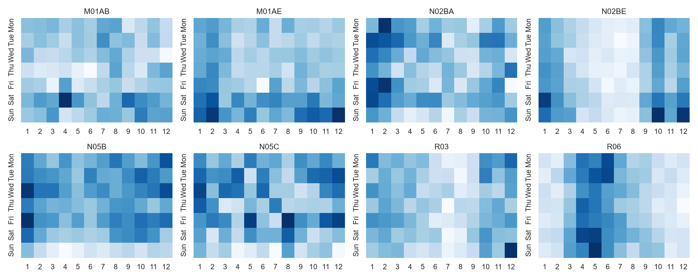
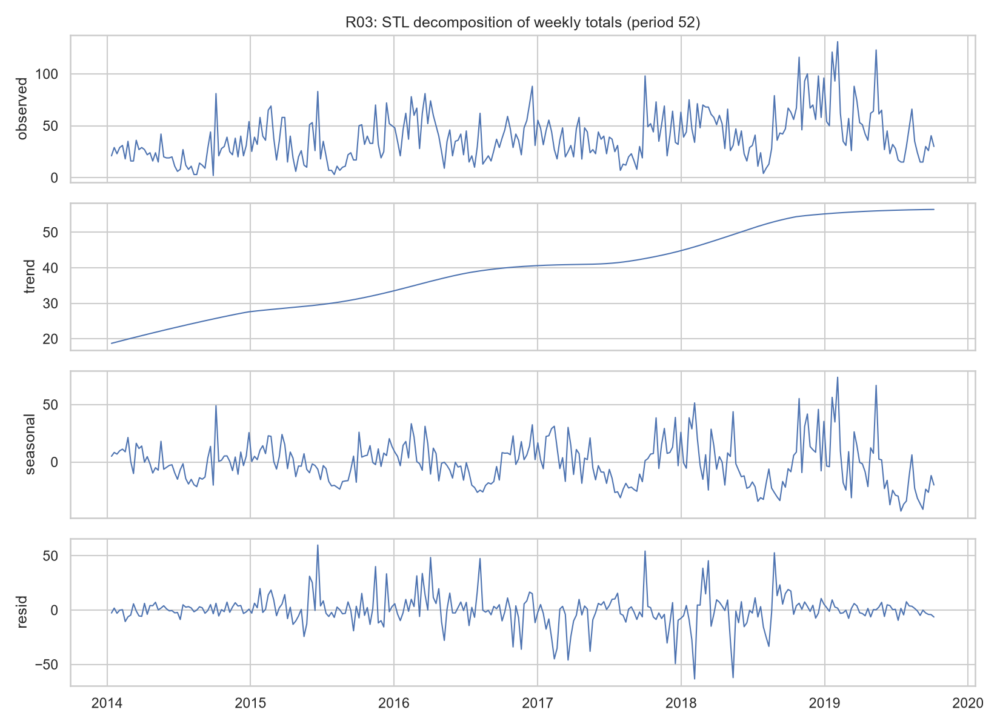
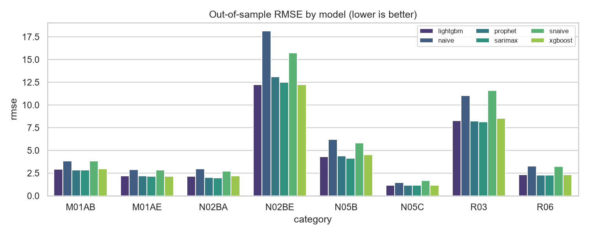
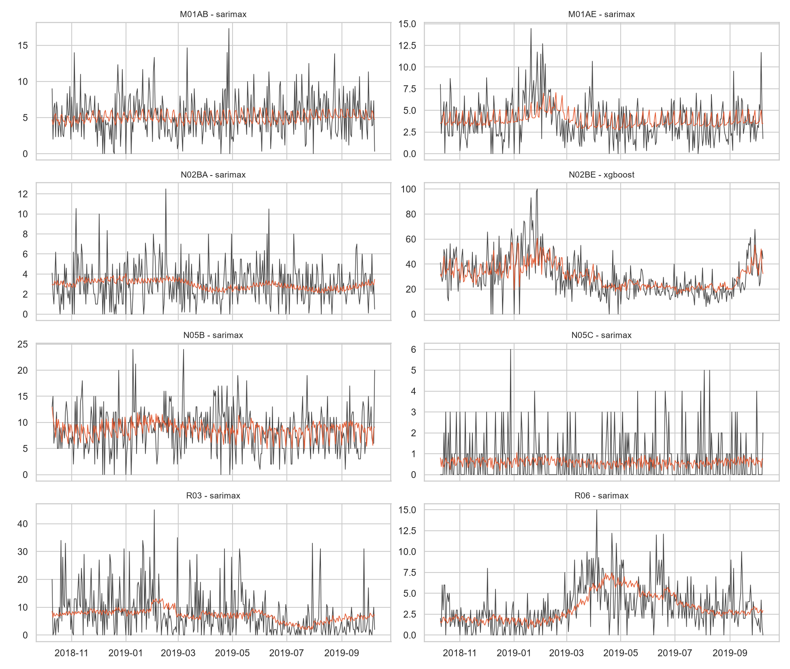
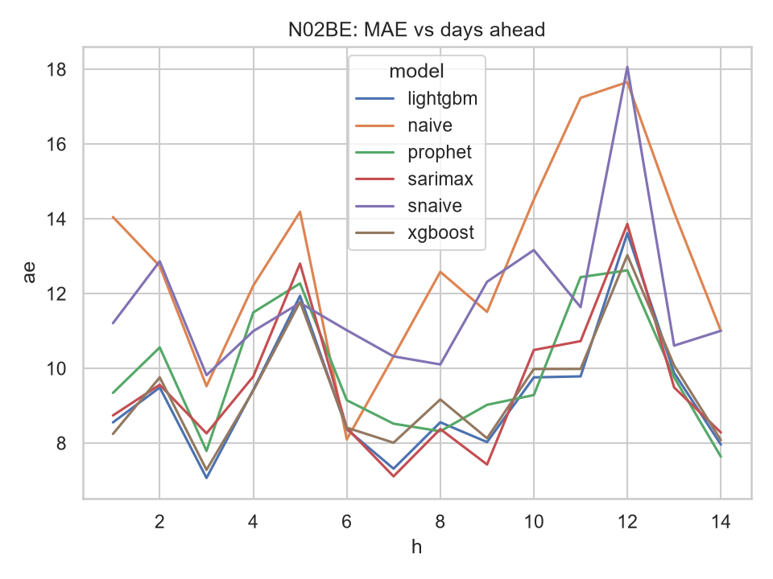
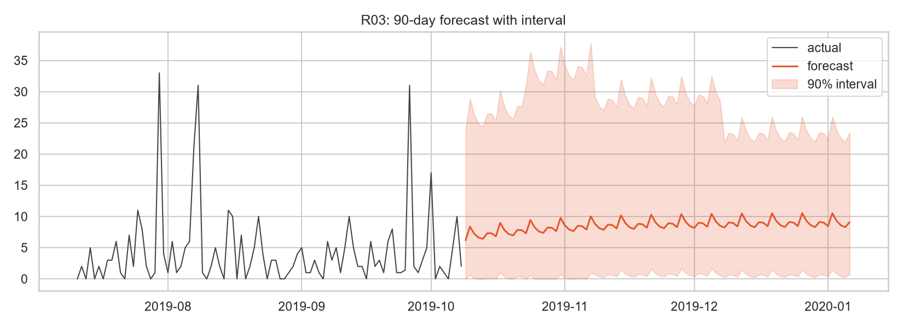
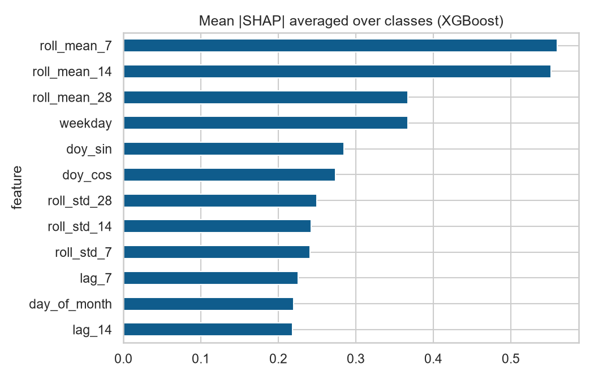

# Pharmaceutical Sales and Medicine Demand Analytics

**B.Tech Data Science · Semester 7 · Individual Project**

> **Reading note.** All sales data in this project is the **real Kaggle "Pharma Sales Data"** (no synthetic data).
> Every number in this report is generated by `python -m src.reporting.build_report` from the files in
> `reports/results/`, which were produced by the executed pipeline. Business parameters that the dataset does not
> contain (prices, costs, lead times, stock on hand, shelf life) are **assumptions** from `config.yaml` and are marked
> *(assumed)* wherever they influence a result.

---

## Abstract

Pharmacies lose revenue and endanger patients through stock-outs, and lose money through expired overstock.
This project builds an end-to-end analytics system on the real Kaggle *Pharma Sales Data*
(2,106 days, 2014-01-02 to 2019-10-08, 8 ATC drug classes, 127,567 units sold).
The system cleans and validates the data, engineers calendar/lag/rolling features, and compares six forecasters
(naive, seasonal naive, SARIMAX, Prophet, XGBoost, LightGBM) with rolling-origin cross-validation
(26 folds × 14-day horizon; the last 364 days are out-of-sample). The best model per series is
selected automatically by RMSE (selected models: SARIMAX (weekly+Fourier): 7, XGBoost (lags): 1). Averaged over series, the selected models reduce MAE by
26.2 % and RMSE by 27.3 % relative to the seasonal-naive baseline.
Forecasts and their forecast errors feed an inventory module (safety stock, reorder point, EOQ, stock-out, overstock and
expiry flags, a what-if simulator) and an interactive 10-page Streamlit dashboard. In a back-test on the final
364 days at a 95% target service level, forecast-driven replenishment raised the volume-weighted fill rate from
96.77 % to 98.01 %, cut lost sales by 38.5 % and changed average inventory value by
-9.8 % compared with a 28-day moving-average rule *(lead times and costs assumed)*.

---

## 1. Introduction and Motivation

Medicines are a special inventory problem. A missing analgesic or anti-asthmatic is not just a lost sale: it is a patient
without treatment. On the other side, pharmaceuticals expire, so holding too much stock ties up capital and eventually
becomes waste. Pharmacies usually decide replenishment from experience or from a simple moving average of recent sales,
which reacts slowly to weekly and annual patterns.

Data science offers a middle path: forecast demand using the patterns in historical sales, quantify the forecast
uncertainty, and translate both into stocking rules whose risk is explicit (a target service level). The project demonstrates this
chain, from raw data to a decision-support dashboard, on real pharmacy sales.

## 2. Problem Statement

> Given historical daily sales of pharmaceutical drug classes, (a) describe demand behaviour, (b) forecast future demand per
> class with quantified uncertainty and (c) convert the forecasts into inventory decisions (reorder points, safety stock,
> order quantities and risk alerts) that reduce stock-outs and overstock.

## 3. Objectives

1. Build a reproducible pipeline that ingests, validates and cleans sales data and logs a data-quality report.
2. Explore trend, seasonality, product mix and demand variability (STL, heatmaps, ABC-XYZ, clustering).
3. Forecast demand with at least four model families and compare them fairly with leakage-free time-series cross-validation.
4. Select the best model per series automatically and provide 7/14/30/90-day forecasts with prediction intervals and SHAP explanations.
5. Convert forecasts into safety stock, reorder point and EOQ at selectable service levels, with stock-out, overstock and expiry-risk flags.
6. Provide a what-if simulator and anomaly detection.
7. Deliver an interactive dashboard, tests, notebooks and documentation.

## 4. Literature Review (brief)

*Classical time-series forecasting.* Box, Jenkins, Reinsel and Ljung [1] established ARIMA/SARIMA models, which remain strong
baselines for seasonal demand; Hyndman and Athanasopoulos [2] give the modern practical treatment, including seasonal naive
benchmarks, STL decomposition and Fourier terms for long seasonal periods, all used here. STL decomposition was introduced by
Cleveland et al. [3]. Prophet [4] models trend, multiple seasonalities and holidays as an additive regression and is popular
for business series with strong calendar effects.

*Machine learning for demand.* Gradient-boosted trees such as XGBoost [5] on lag and calendar features are the workhorse of
modern retail forecasting. The M5 competition on retail unit sales [6] found that tree-based global models with lag features
performed very well, while Makridakis et al. [7] cautioned that machine-learning methods must be benchmarked against
simple statistical methods under a proper out-of-sample protocol. This motivates comparing all families on identical
rolling-origin folds. Model explanations use SHAP [8].

*Evaluation.* Hyndman and Koehler [9] show why percentage errors fail near zero and propose the scaled error (MASE), which is
why this project reports MAE, RMSE, MASE, sMAPE and (zero-excluded) MAPE together. Bergmeir and Benítez [10] discuss
cross-validation for time series; rolling-origin evaluation is used to avoid look-ahead.

*Demand classification and inventory.* Syntetos, Boylan and Croston [11] classify demand patterns by average demand interval
and squared coefficient of variation, the idea behind the XYZ and intermittency labels here. Safety stock, reorder point and EOQ follow
standard inventory theory (Silver, Pyke and Thomas [12]). Isolation Forest [13] is used as a second opinion in anomaly
detection.

*Gap addressed.* Many student projects stop at forecast accuracy. This project links forecasts and their error to concrete
inventory decisions, and tests those decisions in a replay on the out-of-sample period.

## 5. Dataset

**Source:** Kaggle "Pharma Sales Data" (real). The files give quantities sold of eight drug classes identified by ATC code, at
hourly, daily, weekly and monthly resolution. The files do not state the pharmacy's location, and they contain no prices, costs,
stock levels, expiry dates, branches, promotions or transactions. Full column documentation is in
[data_dictionary.md](data_dictionary.md).

| Item | Value |
|---|---|
| Daily file | 2,106 days, 2014-01-02 to 2019-10-08, 8 classes |
| Hourly file | 404,256 class-hour rows (open hours only), used for weekday × hour heatmaps |
| Total units | 127,567 |

**Data quality (logged by `src/data/ingest.py`).** No duplicates, calendar gaps, missing or negative values were found.
7 extreme points were winsorised (conservative rule, see Methodology). Daily sums reconcile with the monthly file:
90.2 % of 70 month-class pairs agree within 1 % (the files do not document the cause of the remaining differences). Zero-sales days matter for modelling:

| category | zero-sales days % | outliers capped |
|---|---|---|
| M01AB | 1.9 | 0 |
| M01AE | 1.7 | 0 |
| N02BA | 3.7 | 0 |
| N02BE | 1.2 | 0 |
| N05B | 2.0 | 1 |
| N05C | 67.9 | 6 |
| R03 | 23.0 | 0 |
| R06 | 12.2 | 0 |

N05C (hypnotics and sedatives) is highly intermittent, which affects metric choice (see Section 8).

**Assumptions (not in the data).**

| category | unit_price | unit_cost | lead_time_days | order_cost | shelf_life_remaining_days |
|---|---|---|---|---|---|
| M01AB | 35.0 | 24.0 | 5 | 500.0 | 120 |
| M01AE | 55.0 | 38.0 | 6 | 500.0 | 120 |
| N02BA | 22.0 | 15.0 | 4 | 500.0 | 120 |
| N02BE | 18.0 | 12.0 | 3 | 500.0 | 120 |
| N05B | 60.0 | 42.0 | 7 | 500.0 | 150 |
| N05C | 75.0 | 52.0 | 7 | 500.0 | 150 |
| R03 | 140.0 | 98.0 | 8 | 500.0 | 100 |
| R06 | 30.0 | 20.0 | 4 | 500.0 | 100 |

Revenue, EOQ, holding cost and expiry value depend on these assumed parameters; forecasts, forecast errors, XYZ variability,
clusters and anomalies depend only on the real sales data.

## 6. Methodology

### 6.1 Pipeline
Ingest → validate schema → remove duplicates → complete the calendar → impute gaps/negatives → winsorise only extreme outliers
→ features → models → evaluation → inventory logic. The data-specific mapping (columns, date formats, layout) lives in
`config.yaml`, so another dataset can be plugged in without code changes.

**Outlier rule.** Robust z-score against a centred 29-day rolling median, with the scale floored at the 99 %-trimmed global standard deviation (the
local MAD collapses to zero on intermittent series and would otherwise flag normal peaks); only |z| > 6 is capped.
Two earlier versions were rejected after inspection and unit tests: a scale from the local MAD alone capped 15 genuine peaks of the intermittent R03 series (e.g. 31 units cut to 14), and a floor equal to the raw global SD was inflated by the very outlier it should catch (a 500-unit spike was only cut to about 190). The final rule and its tests are in `tests/test_data_cleaning.py`.

### 6.2 Features
Calendar (weekday, month, quarter, cyclic day-of-year, month-end), fixed-date festive flags, lags (1, 7, 14, 28), and rolling mean/std (7, 14, 28 days) computed on the *previous*
days only (`shift(1)`). Price and promotion features are implemented but inactive because the dataset has neither. A unit test verifies that changing
future values never changes past features.

### 6.3 Forecasting models

| Model | Specification |
|---|---|
| Naive | last observed value |
| Seasonal naive | value 7 days earlier (baseline for gains) |
| SARIMAX | (1,0,1)(1,1,1)₇ with 3 annual Fourier pairs; fitted on the trailing 3 years |
| Prophet | weekly + yearly seasonality, festive dates |
| XGBoost / LightGBM | 300 trees, depth 4, lag/rolling/calendar features, recursive multi-step prediction |

### 6.4 Evaluation protocol
Rolling-origin (expanding window) cross-validation: 26 contiguous folds of 14 days, so the last 364 days are
out-of-sample. Each fold refits every model on data strictly before the fold. Metrics: MAE, RMSE, MAPE (days with sales > 0), sMAPE, MASE.
**Selection metric: RMSE.** MAE is minimised by a *median* forecast, which on intermittent series is ≈ 0; replenishment needs the *mean*, which RMSE rewards.
(In a 4-fold smoke run, MAE selected the naive model for the two most intermittent series, N05C and R03, which would hand near-zero demand to the planner; the selection metric was changed to RMSE before the full run.)

### 6.5 Prediction intervals
Model-agnostic empirical intervals: forecasts from 8 older origins up to 90 days ahead give standardised residuals (divided by √forecast) whose
5 % and 95 % quantiles per horizon bucket define the 90 % interval. Calibration is checked by calibrating on the older half of the origins and
scoring the more recent half.

### 6.6 Analytics
* **ABC-XYZ:** ABC by cumulative revenue share (A ≤ 80 %, B ≤ 95 %) using assumed prices; XYZ by the coefficient of variation of weekly demand (X ≤ 0.30, Y ≤ 0.45, Z above). Nine cells map to stocking policies.
* **Clustering:** behavioural features → KMeans (k by silhouette) and Ward hierarchical clustering, plus an interpretable rule-based label.
* **Anomalies:** STL (period 7, robust) expected value; Pearson-style residual (÷ √expected) with a MAD-based robust z (scale floored at half the residual SD); |z| > 5; Isolation Forest as a second opinion (“confirmed”).

### 6.7 Inventory formulas
With mean forecast demand d̄ per day, daily forecast-error RMSE σ, lead time L (SD σ_L), service level z:

* Safety stock: SS = z · √(L·σ² + d̄²·σ_L²)
* Reorder point: ROP = d̄·L + SS
* EOQ = √(2·D·S / H), with D annual demand, S order cost, H = holding rate × unit cost
* Status: STOCKOUT RISK if stock < d̄·L; REORDER NOW if below ROP; OVERSTOCK if above the cover limit; expiry risk = max(0, stock − forecast demand until expiry).

### 6.8 Back-test of replenishment policies
Both policies are periodic-review order-up-to rules (review period 14 days, assumed lead times), replayed day by day on the out-of-sample period against actual demand,
with lost sales when stock runs out. They differ only in the demand estimate: a trailing 28-day mean/SD, versus the selected model's forecast with σ taken from its *previous* out-of-sample errors (no look-ahead).

## 7. Implementation

| Layer | Module |
|---|---|
| Data | `src/data/ingest.py`, `store.py` (Parquet + SQLite `pharma.db`) |
| Features | `src/features/engineering.py` |
| Models | `src/models/forecasters.py`, `cv.py`, `metrics.py`, `explain.py` |
| Analytics | `src/analytics/descriptive.py`, `clustering.py`, `anomaly.py` |
| Inventory | `src/inventory/policy.py`, `planner.py`, `whatif.py`, `simulate.py` |
| App | `app/Home.py` and `app/pages/*` (Overview, Sales Explorer, Seasonality, ABC-XYZ, Forecasting, Inventory Planner, What-If, Anomalies, Model Performance, About) |
| Orchestration | `src/pipeline.py` (`data`, `train`, `analyze`), `Makefile` |
| Quality | pytest suite (cleaning, features/leakage, metrics, CV, inventory formulas, planner, anomaly, headless page-render smoke test), ruff, black |

The dashboard offers global filters (date range, category), CSV downloads (forecasts, reorder list, tables), `st.cache_data` caching and tooltips.
A branch filter is built in but hidden because the dataset has a single sales point.

## 8. Results and Discussion

### 8.1 Descriptive findings

**ABC-XYZ** (revenue uses assumed prices; XYZ is from real weekly demand variability):

| category | revenue | revenue share % | abc | weekly CV | xyz | class |
|---|---|---|---|---|---|---|
| R03 | 1,625,235.21 | 31.53 | A | 0.59 | Z | AZ |
| N02BE | 1,134,097.25 | 22.00 | A | 0.36 | Y | AY |
| N05B | 1,117,678.68 | 21.68 | A | 0.36 | Y | AY |
| M01AE | 451,254.03 | 8.75 | A | 0.25 | X | AX |
| M01AB | 371,032.80 | 7.20 | B | 0.24 | X | BX |
| R06 | 183,234.52 | 3.55 | B | 0.56 | Z | BZ |
| N02BA | 179,788.60 | 3.49 | B | 0.29 | X | BX |
| N05C | 92,938.63 | 1.80 | C | 0.73 | Z | CZ |

| category | class | policy |
|---|---|---|
| R03 | AZ | High value, erratic: tight monitoring, higher safety stock, short order cycles, review forecasts often. |
| N02BE | AY | High value, variable: forecast-driven replenishment, moderate safety stock, weekly review. |
| N05B | AY | High value, variable: forecast-driven replenishment, moderate safety stock, weekly review. |
| M01AE | AX | High value, stable: continuous review, lean safety stock, automate replenishment (JIT). |
| M01AB | BX | Medium value, stable: periodic review with fixed order quantities (EOQ). |
| R06 | BZ | Medium value, erratic: buffer stock with caps, order on demand signals. |
| N02BA | BX | Medium value, stable: periodic review with fixed order quantities (EOQ). |
| N05C | CZ | Low value, erratic: stock on request or small buffer; consider delisting if slow. |

**Demand behaviour clusters** (k = 3, silhouette = 0.43; exploratory with only 8 series; labels are relative to the portfolio):

| category | demand_label | kmeans_cluster | hier_cluster | mean_daily | cv_weekly | zero_share | weekly_seasonality | annual_seasonality |
|---|---|---|---|---|---|---|---|---|
| M01AB | Fast-moving | 1 | 0 | 5.034 | 0.238 | 0.019 | 0.222 | 0.051 |
| M01AE | Slow-moving | 1 | 0 | 3.896 | 0.253 | 0.017 | 0.214 | 0.083 |
| N02BA | Slow-moving | 1 | 0 | 3.880 | 0.294 | 0.037 | 0.217 | 0.097 |
| N02BE | Seasonal | 1 | 0 | 29.917 | 0.364 | 0.012 | 0.232 | 0.292 |
| N05B | Fast-moving | 1 | 0 | 8.845 | 0.359 | 0.020 | 0.229 | 0.112 |
| N05C | Intermittent | 2 | 2 | 0.588 | 0.731 | 0.679 | 0.051 | 0.155 |
| R03 | Seasonal & erratic | 0 | 1 | 5.512 | 0.595 | 0.230 | 0.107 | 0.304 |
| R06 | Seasonal & erratic | 0 | 1 | 2.900 | 0.558 | 0.122 | 0.137 | 0.447 |

### 8.2 Forecast accuracy (out-of-sample, last 364 days)

Average over the 8 series:

| model | mae | rmse | smape | mase |
|---|---|---|---|---|
| Naive | 4.53 | 6.23 | 76.01 | 1.10 |
| Seasonal naive (7d) | 4.45 | 5.93 | 76.46 | 1.11 |
| SARIMAX (weekly+Fourier) | 3.32 | 4.40 | 66.41 | 0.82 |
| Prophet | 3.45 | 4.53 | 66.98 | 0.84 |
| XGBoost (lags) | 3.47 | 4.51 | 67.22 | 0.87 |
| LightGBM (lags) | 3.38 | 4.45 | 67.01 | 0.84 |

Number of series in which each model has lower RMSE than the seasonal-naive baseline:

| model | series where RMSE < seasonal-naive |
|---|---|
| LightGBM (lags) | 8 |
| Naive | 2 |
| Prophet | 8 |
| SARIMAX (weekly+Fourier) | 8 |
| XGBoost (lags) | 8 |

Per-series results (lower is better).

**MAE**

| category | Naive | Seasonal naive (7d) | SARIMAX (weekly+Fourier) | Prophet | XGBoost (lags) | LightGBM (lags) |
|---|---|---|---|---|---|---|
| M01AB | 3.02 | 2.96 | 2.21 | 2.21 | 2.31 | 2.29 |
| M01AE | 2.24 | 2.21 | 1.67 | 1.68 | 1.70 | 1.70 |
| N02BA | 2.28 | 2.11 | 1.52 | 1.53 | 1.74 | 1.72 |
| N02BE | 12.84 | 11.78 | 9.52 | 9.87 | 9.38 | 9.27 |
| N05B | 4.83 | 4.54 | 3.25 | 3.50 | 3.65 | 3.46 |
| N05C | 0.93 | 1.11 | 0.85 | 0.87 | 0.93 | 0.88 |
| R03 | 7.58 | 8.49 | 5.80 | 6.16 | 6.28 | 5.95 |
| R06 | 2.50 | 2.41 | 1.72 | 1.75 | 1.79 | 1.77 |

**RMSE**

| category | Naive | Seasonal naive (7d) | SARIMAX (weekly+Fourier) | Prophet | XGBoost (lags) | LightGBM (lags) |
|---|---|---|---|---|---|---|
| M01AB | 3.85 | 3.83 | 2.84 | 2.84 | 2.97 | 2.95 |
| M01AE | 2.90 | 2.83 | 2.14 | 2.18 | 2.16 | 2.18 |
| N02BA | 2.97 | 2.71 | 2.00 | 2.03 | 2.20 | 2.16 |
| N02BE | 18.16 | 15.71 | 12.50 | 13.12 | 12.23 | 12.26 |
| N05B | 6.19 | 5.83 | 4.14 | 4.38 | 4.51 | 4.32 |
| N05C | 1.47 | 1.67 | 1.14 | 1.14 | 1.18 | 1.15 |
| R03 | 11.01 | 11.58 | 8.14 | 8.22 | 8.54 | 8.28 |
| R06 | 3.26 | 3.24 | 2.29 | 2.29 | 2.31 | 2.31 |

**sMAPE %**

| category | Naive | Seasonal naive (7d) | SARIMAX (weekly+Fourier) | Prophet | XGBoost (lags) | LightGBM (lags) |
|---|---|---|---|---|---|---|
| M01AB | 67.17 | 61.50 | 45.71 | 45.85 | 46.66 | 46.43 |
| M01AE | 67.76 | 64.91 | 48.41 | 48.59 | 49.20 | 48.91 |
| N02BA | 81.14 | 77.58 | 55.41 | 56.58 | 58.34 | 58.13 |
| N02BE | 45.92 | 41.97 | 33.68 | 34.57 | 33.69 | 33.09 |
| N05B | 59.43 | 57.91 | 41.91 | 44.14 | 45.33 | 44.01 |
| N05C | 96.09 | 108.95 | 158.00 | 156.30 | 152.52 | 154.31 |
| R03 | 104.10 | 117.08 | 86.22 | 88.39 | 89.07 | 87.77 |
| R06 | 86.45 | 81.79 | 61.95 | 61.38 | 62.97 | 63.42 |

**MASE** (below 1 beats the in-sample seasonal naive)

| category | Naive | Seasonal naive (7d) | SARIMAX (weekly+Fourier) | Prophet | XGBoost (lags) | LightGBM (lags) |
|---|---|---|---|---|---|---|
| M01AB | 1.06 | 1.03 | 0.77 | 0.77 | 0.81 | 0.80 |
| M01AE | 1.01 | 1.00 | 0.75 | 0.76 | 0.77 | 0.77 |
| N02BA | 0.90 | 0.83 | 0.60 | 0.61 | 0.69 | 0.68 |
| N02BE | 1.10 | 1.01 | 0.82 | 0.85 | 0.80 | 0.79 |
| N05B | 0.92 | 0.86 | 0.62 | 0.67 | 0.69 | 0.66 |
| N05C | 1.13 | 1.35 | 1.04 | 1.05 | 1.13 | 1.07 |
| R03 | 1.41 | 1.58 | 1.08 | 1.14 | 1.17 | 1.11 |
| R06 | 1.24 | 1.20 | 0.85 | 0.87 | 0.89 | 0.88 |

**Selected model per series** (win counts: SARIMAX (weekly+Fourier): 7, XGBoost (lags): 1):

| category | model | mae | rmse | smape | mape | mase | MAE gain % | RMSE gain % |
|---|---|---|---|---|---|---|---|---|
| M01AB | SARIMAX (weekly+Fourier) | 2.21 | 2.84 | 45.71 | 67.02 | 0.77 | 25.14 | 25.93 |
| M01AE | SARIMAX (weekly+Fourier) | 1.67 | 2.14 | 48.41 | 105.79 | 0.75 | 24.42 | 24.54 |
| N02BA | SARIMAX (weekly+Fourier) | 1.52 | 2.00 | 55.41 | 96.89 | 0.60 | 27.69 | 26.14 |
| N02BE | XGBoost (lags) | 9.38 | 12.23 | 33.69 | 35.84 | 0.80 | 20.33 | 22.19 |
| N05B | SARIMAX (weekly+Fourier) | 3.25 | 4.14 | 41.91 | 57.65 | 0.62 | 28.38 | 28.96 |
| N05C | SARIMAX (weekly+Fourier) | 0.85 | 1.14 | 158.00 | 59.92 | 1.04 | 23.06 | 31.47 |
| R03 | SARIMAX (weekly+Fourier) | 5.80 | 8.14 | 86.22 | 123.40 | 1.08 | 31.66 | 29.72 |
| R06 | SARIMAX (weekly+Fourier) | 1.72 | 2.29 | 61.95 | 59.27 | 0.85 | 28.90 | 29.41 |

**Discussion.**
* The four non-baseline model families (SARIMAX, Prophet, XGBoost, LightGBM) beat seasonal naive on RMSE in every series. The gain of the selected model over seasonal naive in MAE
  ranges from 20.3 % to 31.7 % (mean 26.2 %; RMSE 27.3 %).
* The differences *between* the top four models are small (see the averages above), so the choice of model matters much less than modelling weekly and annual seasonality at all.
  Selection and reporting use the same folds, so the selected model's advantage is slightly optimistic, and no formal significance test (e.g. Diebold-Mariano) was run.
* Percentage metrics: mean MAPE falls from 98.4 % (baseline) to 75.7 % (selected), a relative gain of 21.9 %.
  MAPE ignores zero-sales days and is unstable for small counts, so it should be read with MAE/RMSE/MASE.
* **sMAPE is misleading for the intermittent series N05C.** The mean-forecast models are worse than naive on sMAPE for N05C (a forecast of exactly 0 scores better on days when sales are 0), yet they are better on MAE, RMSE
  and MASE. Averaged over all series the sMAPE gain is 16.6 %; excluding the 1 intermittent series it is 25.4 % (MAPE: 20.4 %).
* Error does not vanish: daily pharmacy demand is noisy (small integer counts), so even the best model leaves a large daily error. This is why safety stock is driven by the forecast error.

### 8.3 Prediction intervals
Nominal coverage 90 %; empirical coverage on the more recent calibration origins (mean 91.0 %):

| category | model | nominal | empirical_coverage |
|---|---|---|---|
| M01AB | SARIMAX (weekly+Fourier) | 0.900 | 0.839 |
| M01AE | SARIMAX (weekly+Fourier) | 0.900 | 0.928 |
| N02BA | SARIMAX (weekly+Fourier) | 0.900 | 0.928 |
| N02BE | XGBoost (lags) | 0.900 | 0.958 |
| N05B | SARIMAX (weekly+Fourier) | 0.900 | 0.928 |
| N05C | SARIMAX (weekly+Fourier) | 0.900 | 0.881 |
| R03 | SARIMAX (weekly+Fourier) | 0.900 | 0.961 |
| R06 | SARIMAX (weekly+Fourier) | 0.900 | 0.861 |

Coverage is close to nominal on average but varies by series, so intervals are approximate. Each series' coverage is based on a limited number (about 4 origins × 90 days) of
heavily autocorrelated days, so the series-level estimates are noisy.

### 8.4 Explainability
Mean absolute SHAP values of the XGBoost model, averaged over classes (top-3: roll_mean_7, roll_mean_14, roll_mean_28):

| feature | mean |SHAP| (units/day, avg over classes) |
|---|---|
| roll_mean_7 | 0.560 |
| roll_mean_14 | 0.552 |
| roll_mean_28 | 0.367 |
| weekday | 0.367 |
| doy_sin | 0.285 |
| doy_cos | 0.274 |
| roll_std_28 | 0.250 |
| roll_std_14 | 0.242 |
| roll_std_7 | 0.241 |
| lag_7 | 0.225 |

Recent demand level (rolling means) dominates, followed by weekday and the annual cycle (day-of-year sine/cosine) and recent variability. This is consistent with the weekly pattern found by STL (weekly seasonal strength is moderate, about 0.2 for the five stable series; see notebook 01).
SHAP describes the model's behaviour, not causal effects.

### 8.5 Inventory decisions
Default plan at the 95 % service level using the best-model forecast mean over the next 30 days *(lead time, costs assumed)*:

| category | model | mean_daily_forecast | daily_error_rmse | lead_time_days | safety_stock | reorder_point | eoq |
|---|---|---|---|---|---|---|---|
| M01AB | sarimax | 5.0 | 2.8 | 5.0 | 13.3 | 38.2 | 615.4 |
| M01AE | sarimax | 3.8 | 2.1 | 6.0 | 10.6 | 33.4 | 426.7 |
| N02BA | sarimax | 3.0 | 2.0 | 4.0 | 8.3 | 20.5 | 608.7 |
| N02BE | xgboost | 35.8 | 12.2 | 3.0 | 68.4 | 175.6 | 2,332.1 |
| N05B | sarimax | 8.7 | 4.1 | 7.0 | 23.0 | 83.7 | 614.0 |
| N05C | sarimax | 0.6 | 1.1 | 7.0 | 5.1 | 9.5 | 148.4 |
| R03 | sarimax | 7.9 | 8.1 | 8.0 | 40.0 | 102.8 | 382.4 |
| R06 | sarimax | 1.8 | 2.3 | 4.0 | 8.1 | 15.1 | 401.5 |

Stock on hand is not in the data; the dashboard lets the user enter it (default: 20 days of cover) and flags stock-out risk, reorder-now, overstock and expiry risk.
The what-if simulator shows, for example, how a +30 % epidemic surge or a longer lead time raises the reorder point (see notebook 03).

### 8.6 Back-test: forecast-driven vs moving-average replenishment
Replay of the last 364 days, identical lead times, review period and target service level; unmet demand is lost. At 95%:

| Metric | 28-day moving average | Model forecast |
|---|---|---|
| Volume-weighted fill rate | 96.77 % | 98.01 % |
| Stock-out days (mean over classes) | 2.85 % | 2.34 % |
| Lost units (sum) | 741 | 455 |
| Average inventory value at cost (sum, assumed costs) | 25,612 | 23,110 |

Relative to the moving-average policy: stock-out days 18.1 % lower, lost units 38.5 % lower, average inventory value -9.8 % (negative = lower).

All target service levels:

| target SL | policy | fill-rate % | stock-out days % | lost units | avg inventory value (cost) |
|---|---|---|---|---|---|
| 90% | 28-day moving average | 95.99 | 3.50 | 917.76 | 23,571.39 |
| 90% | Model forecast | 97.14 | 3.37 | 654.82 | 21,145.96 |
| 95% | 28-day moving average | 96.77 | 2.85 | 740.63 | 25,611.72 |
| 95% | Model forecast | 98.01 | 2.34 | 455.48 | 23,109.93 |
| 99% | 28-day moving average | 97.84 | 1.85 | 495.15 | 29,588.49 |
| 99% | Model forecast | 98.95 | 1.03 | 239.46 | 27,310.56 |

Per category at 95%:

| category | fill rate (MA28) | fill rate (model) | avg inv. (MA28) | avg inv. (model) |
|---|---|---|---|---|
| M01AB | 0.981 | 0.986 | 56.127 | 50.504 |
| M01AE | 0.942 | 0.962 | 46.502 | 46.273 |
| N02BA | 0.978 | 0.991 | 34.780 | 33.065 |
| N02BE | 0.964 | 0.986 | 295.954 | 302.670 |
| N05B | 0.991 | 0.991 | 90.310 | 91.719 |
| N05C | 0.963 | 0.977 | 14.303 | 10.745 |
| R03 | 0.970 | 0.959 | 133.537 | 110.894 |
| R06 | 0.934 | 0.954 | 40.054 | 36.646 |

**Discussion.** The forecast-driven policy achieved a higher fill rate in 7 of 8 categories; the exceptions are: R03.
"Overstock reduction" is represented here by lower average inventory value; a full expiry simulation would need batch/expiry data that the dataset does not contain.
This is one replay of one year on one pharmacy: there are no confidence intervals, and results depend on the assumed lead times and review period.
They show the *direction* and plausible *size* of the benefit, not a guaranteed saving.

### 8.7 Anomalies
584 days are flagged across all series at |z| > 5 (candidates for review, not confirmed incidents). Almost all are spikes because counts cannot fall below zero:

| category | drop | spike | share of days % |
|---|---|---|---|
| M01AB | 0 | 45 | 2.14 |
| M01AE | 1 | 53 | 2.56 |
| N02BA | 0 | 51 | 2.42 |
| N02BE | 28 | 63 | 4.32 |
| N05B | 2 | 67 | 3.28 |
| N05C | 0 | 120 | 5.70 |
| R03 | 0 | 96 | 4.56 |
| R06 | 0 | 58 | 2.75 |

Largest deviations:

| date | category | actual | expected | z | explanation |
|---|---|---|---|---|---|
| 2016-12-12 | N05B | 28.33 | 1.85 | 23.53 | Spike: 28.3 units vs 1.9 expected (+1427%, residual z = +23.5) |
| 2015-12-31 | N05B | 18.00 | 0.64 | 21.00 | Spike: 18.0 units on a day when only ~0.6 was expected (normally near zero; residual z = +21.0); falls on a festive date |
| 2019-02-28 | R03 | 35.00 | 0.00 | 20.07 | Spike: 35.0 units on a day when only ~0.0 was expected (normally near zero; residual z = +20.1) |
| 2019-04-22 | R03 | 31.00 | 0.42 | 17.53 | Spike: 31.0 units on a day when only ~0.4 was expected (normally near zero; residual z = +17.5) |
| 2014-03-15 | N02BA | 11.00 | 0.37 | 16.06 | Spike: 11.0 units on a day when only ~0.4 was expected (normally near zero; residual z = +16.1) |
| 2019-10-01 | M01AB | 11.34 | 0.05 | 15.93 | Spike: 11.3 units on a day when only ~0.1 was expected (normally near zero; residual z = +15.9) |
| 2019-04-25 | M01AB | 14.01 | 1.29 | 15.83 | Spike: 14.0 units vs 1.3 expected (+989%, residual z = +15.8) |
| 2017-09-25 | R03 | 26.00 | 0.00 | 14.91 | Spike: 26.0 units on a day when only ~0.0 was expected (normally near zero; residual z = +14.9) |

The data has no event log, so causes (outbreaks, promotions, stock-outs, data errors) are hypotheses for the pharmacist to check.

## 9. Limitations

1. **Aggregated classes, one sales point.** Eight ATC classes, not individual medicines or branches; clustering of 8 series is exploratory.
2. **Assumed business parameters.** Prices, costs, lead times, order costs, shelf life and stock on hand are not in the data; revenue, EOQ and expiry results are only as good as these assumptions.
3. **No covariates.** No price, promotion, weather or epidemic data; the what-if price elasticity is assumed, not estimated.
4. **Evaluation.** Model selection and reporting use the same folds (mild optimism); no significance tests; the top models are close.
5. **Intervals** are empirical and approximate (calibration sample is small and autocorrelated).
6. **Back-test.** One year, fixed review period, lost-sales assumption, lead times assumed constant; no expiry or batch simulation.
7. **Anomalies.** Residuals of overdispersed counts are heavy-tailed, so flagged days are candidates; thresholds are heuristic.
8. **Data provenance.** The files do not say which pharmacy or country the data comes from, so no national holiday calendar is used.

## 10. Future Scope

* Hierarchical forecasting at medicine/brand and branch level when such data is available.
* Intermittent-demand methods (Croston/SBA/TSB) for N05C-like series and count-distribution forecasts (negative binomial) for service-level maths.
* Exogenous drivers (weather, epidemics, promotions) and estimation of real price elasticity.
* Formal forecast comparison tests and nested model selection to remove selection optimism.
* Batch/expiry-aware inventory simulation and multi-echelon or multi-supplier replenishment.
* Deep global models (e.g. temporal fusion transformers) once many more series are available.

## 11. Conclusion

On real pharmacy sales, simple seasonal models are strong: SARIMAX with weekly seasonality and annual Fourier terms and gradient-boosted trees all beat the seasonal-naive baseline
in every series, cutting MAE by 26.2 % on average. Because daily demand is noisy, the forecast *error* matters as much as the forecast: feeding it into safety-stock and reorder-point formulas yielded, in an out-of-sample replay, a higher fill rate and fewer lost sales than a moving-average rule at
lower average inventory value (assumed lead times and costs). The project packages the full chain
(cleaning, analysis, forecasting, explanation, inventory decisions, what-if, anomalies) into a tested, reproducible pipeline and an interactive dashboard.

## References

[1] G. E. P. Box, G. M. Jenkins, G. C. Reinsel, G. M. Ljung, *Time Series Analysis: Forecasting and Control*, 5th ed., Wiley, 2015.
[2] R. J. Hyndman, G. Athanasopoulos, *Forecasting: Principles and Practice*, 3rd ed., OTexts, 2021. https://otexts.com/fpp3/
[3] R. B. Cleveland, W. S. Cleveland, J. E. McRae, I. Terpenning, "STL: A seasonal-trend decomposition procedure based on Loess", *Journal of Official Statistics*, 6(1), 3-73, 1990.
[4] S. J. Taylor, B. Letham, "Forecasting at scale", *The American Statistician*, 72(1), 37-45, 2018.
[5] T. Chen, C. Guestrin, "XGBoost: A scalable tree boosting system", *Proc. KDD*, 785-794, 2016.
[6] S. Makridakis, E. Spiliotis, V. Assimakopoulos, "M5 accuracy competition: Results, findings, and conclusions", *International Journal of Forecasting*, 38(4), 1346-1364, 2022.
[7] S. Makridakis, E. Spiliotis, V. Assimakopoulos, "Statistical and Machine Learning forecasting methods: Concerns and ways forward", *PLOS ONE*, 13(3), e0194889, 2018.
[8] S. M. Lundberg, S.-I. Lee, "A unified approach to interpreting model predictions", *Advances in Neural Information Processing Systems* 30, 2017.
[9] R. J. Hyndman, A. B. Koehler, "Another look at measures of forecast accuracy", *International Journal of Forecasting*, 22(4), 679-688, 2006.
[10] C. Bergmeir, J. M. Benítez, "On the use of cross-validation for time series predictor evaluation", *Information Sciences*, 191, 192-213, 2012.
[11] A. A. Syntetos, J. E. Boylan, J. D. Croston, "On the categorization of demand patterns", *Journal of the Operational Research Society*, 56(5), 495-503, 2005.
[12] E. A. Silver, D. F. Pyke, D. J. Thomas, *Inventory and Production Management in Supply Chains*, 4th ed., CRC Press, 2017.
[13] F. T. Liu, K. M. Ting, Z.-H. Zhou, "Isolation forest", *Proc. IEEE ICDM*, 413-422, 2008.
[14] Kaggle, "Pharma Sales Data" (dataset page; confirm the author name and licence on the Kaggle page before submission).

*Reference details were written from memory of the standard citations: check volume/page numbers against the publishers' pages before submitting.*

---

## Appendix: Screenshot checklist

Take these at ≥ 1440 px width after `make app`, and save into `reports/figures/`:

1. **Overview** - KPI cards, monthly revenue area chart, revenue-share donut (`app_overview.png`).
2. **Sales Explorer** - weekly line chart for 3-4 categories, correlation tab (`app_explorer.png`).
3. **Seasonality** - STL panel for R03 or R06 with the weekday × hour heatmap (`app_seasonality.png`).
4. **ABC-XYZ** - Pareto chart + 3 × 3 matrix + policy table; then the cluster tab (`app_abcxyz.png`, `app_clusters.png`).
5. **Forecasting** - category N02BE, 30-day horizon, interval visible, SHAP panels (`app_forecasting.png`).
6. **Inventory Planner** - set days of cover to 5 to show stock-out alerts and 100+ to show overstock/expiry (`app_inventory_alerts.png`); back-test table.
7. **What-If Simulator** - click "Epidemic (+30 % demand)" (`app_whatif.png`).
8. **Anomalies** - R03 chart with markers and the explanation table (`app_anomalies.png`).
9. **Model Performance** - comparison heatmap and best-per-series tab (`app_model_performance.png`).
10. **About** - assumptions table with the warning banner (`app_about.png`).
11. Terminal: `python -m pytest -q` showing all tests passing; `make train` log.
